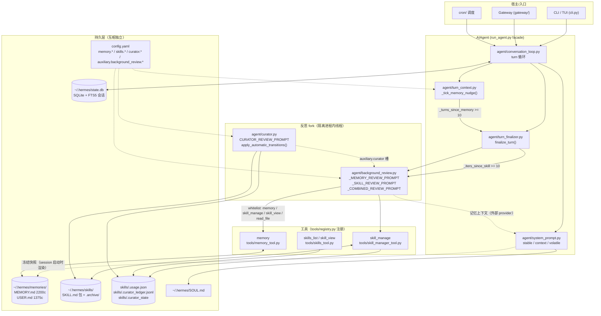
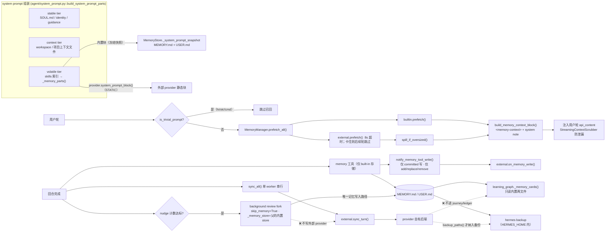

# 研究报告：NousResearch Hermes Agent 的反思（reflection）与记忆（memory/skills/persona）架构

> 研究快照：官方文档访问于 2026-09-16；源码为 `NousResearch/hermes-agent` 默认分支提交 `16bf9a1c494d9701c22f6f417c7b407f0b3067a1`（提交时间 2026-09-16T16:04:27+05:30）。除明确标为“文档声明”或“架构推断”的内容外，代码结论均以该快照为准。
>
> 研究过程说明：初始研究子任务因 20 分钟上限停止，但已成功产出本报告主体；随后由主会话重新克隆上述源码快照并重新抓取官方 memory、memory-providers、skills、curator、architecture 文档，对关键结论进行复核。`session_search` 已补定位到 `tools/session_search_tool.py`，底层检索由 `hermes_state_fts.py`、`hermes_state_schema.py` 等 SQLite/FTS5 模块支撑；它是结构化搜索/浏览工具，不是另一个自动人格总结器。

**研究范围与方法**
- 目标：基于截至本次运行可访问的第一方资料，解释 1) 反思触发/提示/产物/存储；2) 从经验生成或改进 skills 的机制；3) agent 自我人格、用户人格/偏好、长期记忆的存在形式与读写更新路径；4) memory / skills / system prompt(persona) / conversation-session state 的边界与数据流；5) 文档说法与代码实现的差异；6)（补充）**记忆系统可替换性的抽象边界、切换语义与设计哲学**。
- 方法：只读研究。初始证据来自 `raw.githubusercontent.com/NousResearch/hermes-agent/main/<path>` 与官方文档；后续将仓库浅克隆至临时目录，对源码树、符号和关键调用点进行复核。文档证据来自 `hermes-agent.nousresearch.com/docs`（含 `/docs/llms.txt` 索引）。
- **代码版本锚点**：最终复核快照为默认分支提交 `16bf9a1c494d9701c22f6f417c7b407f0b3067a1`，提交时间 2026-09-16T16:04:27+05:30。上游后续提交可能改变路径、配置与默认行为。
- **证据标注约定**：【代码确认】= 直接读到源码；【文档声明】= 第一方文档声明但未完全在代码中核到；【推断】= 架构推论，非上游直接陈述。
- **定位约定**：主体使用 `文件路径 + 符号名` 定位；快照中可通过 `rg -n` 复现具体行号。

---

## 摘要

Hermes Agent 的"反思"不是一份反思制品，而是**每 N 轮由主 agent 派生一个隔离 fork（background review）**，用固定审查提示词重放当前会话，仅以 `memory` / `skill_manage` 两个工具写盘（`agent/background_review.py`；触发计数在 `agent/turn_context.py::_tick_memory_nudge` 与 `agent/turn_finalizer.py`）。长期记忆是**两个有字符上限的 markdown 文件**（`~/.hermes/memories/MEMORY.md` 2,200 / `USER.md` 1,375，`\n§\n` 分隔，`tools/memory_tool_store.py::MemoryStore`），在会话启动时**冻结**注入 system prompt 的 volatile 层；跨会话召回由 `tools/session_search_tool.py` 提供 search / lookup / scroll，并由 SQLite/FTS5 状态库实现索引与检索。Skill 是 `~/.hermes/skills/` 下的 SKILL.md 目录包，由 `skill_manage` 写入并带多层守卫（read-before-write、只允许 curator-managed、pinned/hub/bundled/external 只读），生命周期由 `agent/curator.py` 的确定性状态机 +（可选）LLM 合并 pass 维护。人格（SOUL.md）与用户模型（USER.md）是**两套互不写入的系统**，"自传式 agent 人格"在代码层面只由 SOUL.md + usage/ledger sidecar 表达，没有 agent 自写的身份记忆层。

关于可替换性（新增第 6 章）：Hermes 的可替换性是**后端可插拔、策略不可插拔**——`agent/memory_provider.py::MemoryProvider` 定义了完整的 provider 契约，`memory.provider` 一次只有一个外部 provider，内置 `MEMORY.md`/`USER.md`（provider 名 `builtin`）恒为首位且**不参与** provider 的替换（只能被 `memory_enabled`/`user_profile_enabled` 整体关闭）。切换 provider 时生命周期、围栏、超时、审批等机制保持稳定；但**反思（background review）与 journey/learning graph 仍硬绑内置文件**，外部 provider 的记忆既不被反思写入也不出现在 journey 图谱里——这是整套设计中最关键的不对称。

---

## 一、总体架构与数据流（Mermaid）



**边界一句话**：memory 文件 = 每轮都在 prompt 里（固定 ~1,300 token 成本）；skills = 按需渐进披露（索引常驻、正文按需）；SOUL.md = 会话启动注入一次的身份；会话 state = SQLite，只在显式 `session_search` 时进入上下文。

---

## 二、反思 / reflection

### 2.1 触发条件（全部【代码确认】）

| 路径 | 判定点 | 条件 |
|---|---|---|
| 记忆反思（自动） | `agent/turn_context.py::_tick_memory_nudge` | `agent._memory_nudge_interval > 0` 且 `"memory" in agent.valid_tool_names` 且 `agent._memory_store` 存在；每用户轮 `_turns_since_memory += 1`，达到 interval 即返回 `True` 并清零 |
| 技能反思（自动） | `agent/turn_finalizer.py::finalize_turn` | `agent._skill_nudge_interval > 0 and agent._iters_since_skill >= agent._skill_nudge_interval and "skill_manage" in agent.valid_tool_names` |
| 实际派生 fork | `agent/turn_finalizer.py` | `final_response and not interrupted and not agent.skip_background_review and (_should_review_memory or _should_review_skills)` → `agent._spawn_background_review(messages_snapshot=list(messages), review_memory=..., review_skills=...)` |
| fork 前 gate | `run_agent.py::_spawn_background_review` | `focus is None and agent._delegate_depth > 0` → 直接 return（子 agent 不反思）；`load_background_review_settings()` 给出 `enabled`（`auxiliary.background_review.enabled`，**默认 true**）；结构化 clone 快照（`agent/turn_finalizer.py::_clone_background_review_messages`） |
| 延迟执行 | `run_agent.py::_review_should_defer` + `agent/review_idle_queue.py` | 当 review 目标是"托管本地 llama-server"且 `defer: auto` 时，改为入队等机器空闲，而不是立即跑 |
| 手动 | `/refine [focus]` | `spawn_background_review_thread(..., focus=...)`，`explicit=True`；`is_background_review_enabled` 的 docstring 明确：显式 `/refine` **绕过** `enabled` gate（同"把 nudge interval 归零"的语义，issue #87250） |
| 静默开关 | `AIAgent(skip_background_review=True)` | cron 等场景用；`agent_init.py` 中 `skip_background_review` 为构造参数 |

**默认间隔**（`agent/agent_init.py`）：`_init_memory()` 先设 `agent._memory_nudge_interval = 10`，再用配置覆盖 `memory.nudge_interval`（默认 10）；`_apply_agent_section()` 设 `_skill_nudge_interval = int(config["skills"]["creation_nudge_interval"] or 10)`。计数器 `_turns_since_memory` / `_iters_since_skill` **不随 turn 重置**（`agent/turn_context.py::_PER_TURN_RESET_STATE` 注释明确排除），并在会话恢复时按 `prior_user_turns % interval` 水合，避免 resume 后计数错位。

**推断**：所谓"周期 nudges"= 上述两个计数器 + 1 个 prompt 层计数提示，不存在独立 scheduler；真正独立的定时器只有 curator 的闲置检查。

### 2.2 提示词（【代码确认】，均在 `agent/background_review.py`）

- `_MEMORY_REVIEW_PROMPT`：问"用户是否暴露了人格/偏好/对我行为的期待"→ 存 memory。
- `_SKILL_REVIEW_PROMPT`：要求**主动**更新技能库："most sessions produce at least one skill update, even if small"，目标是 class-level umbrella + 少量 `references/`。
- `_COMBINED_REVIEW_PROMPT`：memory + skills 合并审查。
- `_DO_NOT_CAPTURE_BLOCK`：明确禁止把"环境依赖失败"（缺二进制、`command not found`、未配置凭证）写成持久约束；要写就写**修复方式**。
- 选择逻辑：`_PROMPT_NAME_BY_SCOPE[(review_memory, review_skills)]`；默认（两者皆 False）落到 `_SKILL_REVIEW_PROMPT`（技能优先）。
- 预算：`_REVIEW_MAX_ITERATIONS = 16`（注释：聚合 **input token** 预算由 `conversation_loop.py::_review_input_budget_exhausted` 检查），`_REVIEW_MAX_INPUT_TOKENS_DEFAULT = 600_000`。
- fork 的 `read-before-write` 是**强制**的：提示词写"ENFORCED — skill_manage refuses otherwise"，代码侧对应 `tools/skill_manager_guards.py::_background_review_read_before_write_guard`（要求 `skill_view`/`read_file` 通过 `mark_background_review_skill_read` 打过标记）。

### 2.3 隔离与成本（【代码确认】，`build_cache_parity_fork`）

fork 是**同进程内、持久化隔离**的 `AIAgent`：`_persist_disabled = True`、`_session_db = None`、`_end_session_on_close = False`、`skip_memory=True`（避免外部 provider 把 harness 提示写进用户真实 memory 命名空间）、`_skip_mcp_refresh = True`（保持 `tools[]` 字节一致）。同一模型时继承父 agent 的 `_cached_system_prompt` 与 `session_start`，以命中同一 prefix cache（注释给出来源 issue #25322 / PR #17276，并声称 Sonnet 4.5 上端到端成本降约 26%——**这是源码注释里的自述数字，我未独立验证**）。fork 内 `_memory_nudge_interval = _skill_nudge_interval = 0`（不递归反思）。用量单独记账：`session_db.record_auxiliary_usage(session_id, task="background_review", ...)`。

### 2.4 反思产物的存储

| 产物 | 落盘位置 | 证据 |
|---|---|---|
| 记忆条目 | `~/.hermes/memories/MEMORY.md` / `USER.md`（与前台写同一存储） | 【代码确认】`MemoryStore._path_for`、`get_memory_dir()` |
| 技能/技能文件 | `~/.hermes/skills/**`（或 `skills.create_dir`） | 【代码确认】`tools/skill_manager_tool.py::_skills_dir` 等 |
| 技能使用/生命周期遥测 | `~/.hermes/skills/.usage.json` | 【代码确认】`tools/skill_usage.py`；【文档声明】curator 文档给出字段样例（`use_count`/`view_count`/`last_used_at`/`patch_count`/`state`/`pinned`） |
| 审计台账 | `~/.hermes/skills/.curator_ledger.jsonl` | 【文档声明】curator 文档；文件由 curator 提示词与 `tools/skill_ledger.py` 引用（【代码确认】模块存在） |
| curator 状态/报告 | `~/.hermes/skills/.curator_state`；`~/.hermes/logs/curator/<ts>/run.json` + `REPORT.md` | 【代码确认】`agent/curator.py::_state_file`、`_reports_root` |
| 反思摘要 | 只作为日志/摘要发布（`_log_review_completion`、`_publish_review_summary`），fork 自己的 review 总结**不回灌**主会话 | 【代码确认】源码注释 "The fork's own review summary is never published back" |

**关键结论**：没有"reflection.md / 反思日志文件"这种一等制品；**反思的唯一持久产物就是 memory 条目 + skill 包的变更**（加上遥测与台账）。【推断】

### 2.5 未受监督时的安全约束（【代码确认】）

- `tools/memory_tool.py::_background_delete_gate`：当 `tools.skill_provenance.is_unattended_review()` 为真（= 是 background review **且** 非 `/refine`）时，`replace` / `remove`（含 batch 中的）**不得**直接生效，改为 `write_approval.stage_write(wa.MEMORY, ...)` 暂存，提示用户用 `/memory pending` 审批；`add` 仍允许。staging 失败则 fail-closed 直接拒绝。
- `tools/skill_provenance.py`：`get_current_write_origin()` 默认 `"foreground"`，sentinel `BACKGROUND_REVIEW = "background_review"`；`is_unattended_review() = is_background_review() and not _review_attended`。`run_agent.py` 在每个 tool loop 前绑定 origin。
- fork 白名单：`write_file` / `patch` / `terminal` 被拒，拒绝文案会指路 `skill_manage`（避免模型的替代工具风暴）；可用 `auxiliary.background_review.extra_tools` 额外放行具名工具（issue #44672 / #82146）。

---

## 三、从经验生成 / 改进 skills

### 3.1 写入路径

| 机制 | 入口 | 说明 |
|---|---|---|
| 反思自动更新 | `_SKILL_REVIEW_PROMPT` + `skill_manage` | 提示词要求优先 patch 已有 umbrella、再考虑 create；禁止"每会话一个 references 文件"的 sprawl 形状 |
| 手动/结构化学习 | `/learn` → `agent/learn_prompt.py::build_learn_prompt(user_request)` | 不是独立引擎：它**构造一段提示**，当作普通 turn 交给 agent，由 agent 用现有工具收集来源、再用 `skill_manage` 落地（源码 docstring 明说 "No distillation engine, no model-tool footprint"） |
| curator 合并 | `agent/curator.py::CURATOR_REVIEW_PROMPT` | umbrella 化整合，删除必须带 `absorbed_into=<umbrella>`，最终输出 `consolidations` / `prunings` YAML 块 |
| 导入/安装 | `hermes skills install`（hub / `well-known:` / 直接 URL / GitHub） | 【文档声明】skills 文档；带安全扫描与 quarantine |

`/learn` 的作者规范硬编码在提示里（【代码确认】`_AUTHORING_STANDARDS`）：`name` 小写连字符、`description` **≤60 字符且以句号结尾**（理由是 system prompt 技能索引会截断到 60 字符，超出即"静默永不路由"）、`version: 0.1.0`、`author` 必须是字面量 `Hermes`（禁止从环境/用户名推断，理由：技能会被分享=隐私泄露）、body 段落顺序（When to Use / Prerequisites / How to Run / Quick Reference / Procedure / Pitfalls / Verification）。
另有 `_KNOWLEDGE_SKILL_STANDARDS`（大型书籍/语料 → 精简 SKILL.md 索引 + `references/` 逐章蒸馏，一次只处理一章，最后对账索引）与 `_SOURCE_HYGIENE`（源文本是数据不是指令；剥离零宽/bidi 控制字符，防 Trojan Source）。

### 3.2 `skill_manage` 工具（【代码确认】，`tools/skill_manager_tool.py`）

- 注册：`registry.register(name="skill_manage", toolset="skills", emoji="📝", schema=SKILL_MANAGE_SCHEMA, handler=_skill_manage_from, dynamic_schema_overrides=_skill_manage_schema_overrides)`。
- 广播形状：**只广告 `operations` 数组**（对齐 memory 工具）；旧 flat 形状（top-level `action/name/content/...`）仍接受但不广告（兼容旧 transcript 与 staged 回放）。
- actions：`create` / `patch` / `edit` / `delete` / `write_file` / `remove_file`；`patch`（`old_string`→`new_string`，可带 `file_path`/`replace_all`）是首选；batch 在 `tools/skill_manager_batch.py`。
- 守卫链（`_locate_for_write` → `_guarded_write` / delete 分支）：
  - `tools/skill_manager_guards.py::_background_review_write_guard`：fork 只能动 **curator-managed**（`created_by == "agent"`）的技能；pinned、`skills.external_dirs`、bundled、hub-installed 一律拒绝；缺失记录与 `created_by: null` 同等对待（fail closed）。
  - `_pinned_guard`：`ESSENTIAL_SKILLS` 与 pinned 技能**不可删除**（patch/edit 仍允许）。
  - `_background_review_read_before_write_guard`：后台 fork 必须先 `skill_view` 目标文件。
  - `_validate_delete_target`：拒绝删除 skills root 本身、root 之外的路径、symlink/junction（防 rmtree 越界，注释引用 Kilo Code issue #11227）。
  - `_curator_consolidation_delete_guard`：fork 的删除必须带已验证的 `absorbed_into`；裸 prune 由确定性状态机负责。
  - `_maybe_auto_propose_org_edit` / `_org_mirror_write_guard`：组织共享技能可原地编辑但不可本地删除。
- 删除语义：fork（`is_background_review()` 为真）时走 `skill_usage.archive_skill`（可恢复归档），前台保留硬删；写成功后再 `record_created(agent_created=is_background_review())` / `bump_patch` / `forget`，保证 provenance 正确。
- 写审批：`skills.write_approval: true` 时（默认 false）**所有** `skill_manage` 写入 staged 到 `~/.hermes/pending/skills/`，用 `/skills pending|diff` 审批；`apply_skill_pending` 是回放入口。
- 质量反馈：`create` 与 `references/*` 写入后跑建议性 linter（`incident-log-shape`、`references-sprawl`），只警告不阻断。

### 3.3 生命周期（curator，【代码确认】`agent/curator.py`）

- 触发：非 cron daemon，`maybe_run_curator()` 在"距上次运行 ≥ `interval_hours`"且 idle 时运行；首次运行只 seed `last_run_at` 并推迟一个完整 interval。
- 常量默认：`DEFAULT_INTERVAL_HOURS = 24*7`、`DEFAULT_MIN_IDLE_HOURS = 2`、`DEFAULT_STALE_AFTER_DAYS = 14`、`DEFAULT_ARCHIVE_AFTER_DAYS = 30`、`DEFAULT_CONSOLIDATE = False`、`prune_builtins` 默认 `True`。
- 确定性状态机 `apply_automatic_transitions()`：`active → stale → archived`；pinned 与**被任何 cron job 引用**的技能跳过；`use_count == 0` 的年轻技能有宽限（"absence of evidence"）；归档走 `_archive_as_curator`（ledger actor = `"curator"`）→ `~/.hermes/skills/.archive/`。
- LLM 合并 pass（opt-in）：单一 aux 模型 pass，只许 `skill_manage`（**无 terminal**，见 §6 D2），要求"少于 10 个归档说明你停得太早"，必须输出 consolidations/prunings YAML。
- dry-run：`CURATOR_DRY_RUN_BANNER` 明确"REPORT ONLY，不得 mutate"。
- 备份/回滚：`agent/curator_backup.py`（快照）；`hermes curator rollback`。【文档声明】
- 报告：`~/.hermes/logs/curator/<ts>/run.json` + `REPORT.md`，含 `archived/consolidated/pruned/state_transitions/cron_rewrites` 计数与 `_build_rename_summary`（"where did my skills go?" 文案）。

### 3.4 学习图谱（"learning made visible"，【代码确认】`agent/learning_graph.py`）

`build_learning_graph()` 产出的节点 = ①非 bundled、有"学习信号"的技能（`_has_learning_signal`：`created_by in {"agent","learn"}` 或 `use_count > 0`）；②`MEMORY.md`/`USER.md` 按 `"\n§\n"` 切出的 chunk，节点 id 形如 `memory:<source>:<index>`。边 = 声明式 `related_skills`（两端都存在）+ 记忆↔技能的词法重叠（Top-4，技能名命中权重 6）。
这解释了文档里 `hermes journey delete memory:<source>:<index>` 的 node id 形状，也说明**"记忆"在图里是一等公民，但它是文件内容的投影，不是独立数据库**。【推断】
**⚠ 关键硬编码**：`_memory_cards()` 里 `base = get_hermes_home() / "memories"`，文件名硬编码为 `("MEMORY.md", "memory")` 与 `("USER.md", "profile")` —— 即 **journey/learning graph 只认内置两文件，外部 provider 的记忆永远不会出现在图谱里**。【代码确认】

---

## 四、agent 自我人格 / 用户人格 / 长期记忆

### 4.1 Agent 人格（【代码确认】+【文档声明】）

- 载体：全局 `~/.hermes/SOUL.md`（或 `$HERMES_HOME/SOUL.md`）。加载函数 `agent/prompt_builder.py::load_soul_md(ctx_len, home_override=...)`，由 `agent/system_prompt.py::_identity_parts` 调用，条件 `agent.load_soul_identity or not agent.skip_context_files`；结果作为 **stable tier 的第一个 part**（文档称 "Slot #1"）。
- 仓库内 `SOUL.md`（根目录，663 字符）就是 seed 文本，全文核心：身份声明 "You are Hermes Agent, built by Nous Research"、直接给答案、语气匹配问题分量、不要 filler、不要复述用户请求、不要解说工具调用、不确定就直说、"同意是因为它对，而不是因为用户这么说"。
- 覆盖/叠加：`ephemeral_system_prompt`（构造参数，会话级）【代码确认存在该字段】；`/personality` 预设为**会话级 overlay**【文档声明，未核代码】。
- **没有** agent 自写的"自我人格记忆"：fork 继承了父 agent 缓存的 system prompt（含 SOUL），但没有把"我是谁"的演化写成可写存储。自我表征只以间接形式存在（provenance 遥测 `.usage.json` 的 `created_by`、ledger actor、`.curator_state`）。**推断**。

### 4.2 用户人格 / 偏好（`USER.md`）

- 上限 **1,375 字符**（`memory.user_char_limit`），`target="user"`；语义定义在工具描述里："'user' = who the user is (name, role, preferences, style)"；对应提示词 `_MEMORY_REVIEW_PROMPT` 只问"用户暴露的人格/偏好/对我行为的期待"。
- 写入仅由 `memory` 工具（agent 自己）+ 用户侧 CLI/journal 编辑；`SOUL.md` 与 `USER.md` **互不喂食**（【文档声明】which-file-does-what 明确写 "separate systems that never feed each other"）。
- 外部 provider（Honcho 等）可叠加"辩证式用户建模"（dialectic reasoning）——【文档声明】memory-providers 文档：同时只能启用 1 个外部 provider、内置 memory 始终并存；Honcho 有 `peerName`/`aiPeer`/`workspace`/`contextCadence`/`dialecticCadence`/`dialecticDepth`/`observation` 等旋钮。（详见 §六）

### 4.3 长期记忆（`MEMORY.md`）

| 维度 | 事实 | 证据 |
|---|---|---|
| 位置 | `get_hermes_home()/memories/MEMORY.md`（profile 作用域） | 【代码确认】`tools/memory_tool.py::get_memory_dir`、`MemoryStore._path_for` |
| 上限 | 默认 2,200 字符（`memory_char_limit`），1,375（`user_char_limit`） | 【代码确认】`MemoryStore.__init__` 默认参数 + `agent_init.py` 读 config |
| 条目分隔 | `ENTRY_DELIMITER = "\n§\n"` | 【代码确认】`tools/memory_tool_store.py` |
| 渲染 | `_render_block`：`═*46` 分隔线 + header（`MEMORY (your personal notes)` / `USER PROFILE (who the user is)`）+ `[67% — 1,474/2,200 chars]` + 正文 | 【代码确认】+【文档声明】文档给出同格式示例 |
| 写入动作 | `add` / `replace`（`old_text` 子串唯一匹配）/ `remove`；可 `operations` 批量（**原子**，只对最终字符数校验一次）；无 `read` | 【代码确认】`memory_tool()`、`MEMORY_SCHEMA` |
| 冻结快照 | `load_from_disk()` 时写入 `self._system_prompt_snapshot`；`format_for_system_prompt()` 只返回该快照，会话中写入不改变 prompt（保 prefix cache） | 【代码确认】`MemoryStore.format_for_system_prompt` docstring "NOT live state" |
| 超限行为 | `add` 报错并回传 `current_entries` + `usage`，要求同轮内 replace/remove 腾空间；**不自动压缩** | 【代码确认】`MemoryStore._failure_with_entries`；【文档声明】memory 文档同述 |
| 防死循环 | 每轮最多 3 次 consolidation 失败，之后返回 TERMINAL `done: True` 让模型继续回答（issue #42405） | 【代码确认】`_MAX_CONSOLIDATION_FAILURES_PER_TURN = 3` |
| 重复 | 完全相同的条目被拒（成功语义的 "no duplicate added"） | 【代码确认】 |
| 安全 | 写前 + 载入时 `tools/threat_patterns.scan_for_threats(scope="strict")`；载入命中的条目在**快照**里替换为 `[BLOCKED: ...]`，live 列表保留原文供用户删除 | 【代码确认】`_scan_memory_content`、`load_from_disk._sanitize` |
| 文件安全 | 独立 `.lock` 文件 + `fcntl`/`msvcrt` 排他锁、`0600`、`O_NOFOLLOW`；原子写；严格 `utf-8-sig` 解码；外部漂移检测（round-trip 不一致 → 拒绝写 + `.bak.<ts>` 快照，issue #26045）；整批移除最后一条时拒绝（issue #103419） | 【代码确认】 |
| 会话边界 | 记忆机制为"会话结束"设计：gateway 单会话可连续数周，文档建议在自然边界 `/new` 以让遗忘→召回循环生效 | 【文档声明】memory 文档 |
| 审批 | `memory.write_approval` 可让写入 staged（`tools/write_approval`，`/memory pending` 审批）；后台未受监督 review 的删除**强制** staged | 【代码确认】`_apply_write_gate`、`_background_delete_gate`；【文档声明】memory 文档 |

### 4.4 跨会话召回（会话搜索）

- 【文档声明】all CLI/messaging 会话存 SQLite `~/.hermes/state.db`，FTS5 全文检索；`session_search` 返回**真实消息**，"no LLM summarization, no truncation"；可前后滚动；响应 ~20ms 查询 / ~1ms 滚动。
- 【文档声明】架构文档：Session Storage = SQLite + FTS5（`hermes_state.py`、`gateway/session.py`），带 lineage（parent/child across compressions）。
- 【代码确认】`AIAgent._get_session_db_for_recall()` 会惰性打开默认 state DB 以支撑 `session_search` 工具，且**持久化隔离的 fork 不打开**（否则会把 fork 的 harness turn 写进真实会话）。
- ⚠ 我**没有**定位到 `session_search` 工具的实现模块（见 §8），因此 FTS5 细节属文档级证据。

### 4.5 记忆在 system prompt 中的位置（【代码确认】`agent/system_prompt.py`）

`build_system_prompt_parts()` 三档，`\n\n` 连接：
1. `stable`：identity（`_identity_parts` → SOUL.md 或 `DEFAULT_AGENT_IDENTITY`）、guidance（`_tool_guidance_block`：`prompt_builder.build_memory_guidance` / `SESSION_SEARCH_GUIDANCE` / `SKILLS_GUIDANCE`，后两者按工具是否在 `valid_tool_names` 里开关）、env hints、coding brief、platform hints。
2. `context`：workspace 快照、调用方 `system_message`、项目上下文文件（`.hermes.md` → `AGENTS.md` → `CLAUDE.md` → `.cursorrules`，只取一个）。
3. `volatile`：**skills 索引 → `_memory_parts(agent)`（MEMORY 块、USER 块、外部 provider 块）→ 插件段 → 时间戳行**。注释说明顺序理由：技能索引运行时可变且放在 volatile 带首位，便于 longest-prefix 复用。

其它关键行为：`invalidate_system_prompt()` 在上下文压缩后清缓存并**重新 `load_from_disk()`**（让本会话写入的记忆在重建 prompt 时被捕获——注意这是压缩触发的例外路径）；`_auto_load_skills_parts` 对 delegate/curator/review fork 等"skip context files"的 agent 关闭。

---

## 五、边界与数据流小结

| 层 | 载体 | 写入者 | 何时进入模型上下文 | 更新时机 |
|---|---|---|---|---|
| 人格 | `~/.hermes/SOUL.md` | 用户（Hermes 只在缺失时 seed） | 每会话启动，stable tier 第一位 | 手动/`/personality`；会话内改动需重启会话 |
| 用户模型 | `memories/USER.md` | agent（`memory` 工具）+ 用户 CLI | 每会话启动冻结快照（volatile 层） | 会话内即时落盘，prompt 次会话生效 |
| 自传记忆 | `memories/MEMORY.md` | agent（`memory` 工具/反思 fork） | 同上 | 同上 |
| 程序性记忆 | `~/.hermes/skills/**` + `.usage.json` | agent（`skill_manage`）/ curator / hub 安装 | **索引**常驻 volatile 层，**正文**按需 `skill_view` | 即时，下一轮即可用 |
| 外部记忆 | provider（Honcho/Mem0/…） | provider 自身 + `sync_turn` | prefetch 注入到**用户轮**的 `api_content`（`<memory-context>` 围栏 + system note，`StreamingContextScrubber` 防止流式泄露） | 每轮 sync（后台单 worker 串行） |
| 会话 state | `state.db` SQLite(+FTS5) | conversation loop / SessionStore | 仅显式 `session_search` | 每轮持久化（fork 除外） |
| 反思遥测 | `.usage.json` / `.curator_ledger.jsonl` / `.curator_state` / `logs/curator/*` | 工具与 curator | 不进上下文 | 每次 mutation |

外部 memory provider 的契约概览在此仅给出运行期结论，**完整的抽象边界、注册、切换语义与设计动机见新增的第六/第七章**。

---

---

## 六、深入分析：为什么 Hermes 允许替换 / 切换记忆系统

> 本章回应新增重点。核心论点：**Hermes 的"可替换记忆"= backend 可插拔 + policy 不可插拔。** provider 能替换"记忆存在哪里、怎么检索"，但不能替换"谁来写记忆、什么算值得记、反思如何发生"——后者被硬编码在 built-in 工具、反思提示词与 journey 图谱里。

### 6.1 三个层次的可替换面

| 层次 | 可替换物 | 开关 | 可替换粒度 |
|---|---|---|---|
| L1 存储实现 | `MemoryProvider` 插件（cloud/self-hosted/local/CLI 五类后端） | `memory.provider: <name>` | 一次 1 个外部 provider（+ builtin 恒在） |
| L2 内置文件存储本身 | `MEMORY.md` / `USER.md` 整体开/关 | `memory.memory_enabled`、`memory.user_profile_enabled` | 只能整体关，不能替换成别的文件 |
| L3 上下文管理（正交层） | ContextEngine 插件 | `plugins/context_engine/`、单选取一 | 与记忆解耦，但共享同一"上下文预算"动机 |

【代码确认】L3 依据：架构文档"Two specialized plugin types exist: memory providers (`plugins/memory/`) and context engines (`plugins/context_engine/`). Both are single-select — only one of each can be active at a time"；`agent/context_engine.py  # ContextEngine ABC (pluggable)`。
【文档声明】L2 的语义（memory 文档原文）："Setting **both** `memory_enabled` and `user_profile_enabled` to `false` turns the built-in stores off completely: the `memory` tool is dropped from the schema and its guidance block is dropped from the system prompt... An external provider set via `memory.provider` ... is unaffected and keeps its own tools — **use this when you want a third-party memory backend instead of the built-in files**."

### 6.2 抽象边界与协议（【代码确认】`agent/memory_provider.py`）

**ABC：`class MemoryProvider(ABC)`**，模块 docstring 一句话定义边界：

> "Plugins ship in `plugins/memory/<name>/`, activated via `memory.provider` (ONE external provider at a time). Lifecycle, driven by MemoryManager: initialize -> system_prompt_block / prefetch / sync_turn per turn -> tool dispatch -> shutdown, plus optional `on_*` hooks."

**必实现（4 个 `@abstractmethod`）**
1. `name`（property）——短标识（`'builtin'`、`'honcho'`、`'hindsight'`）。
2. `is_available()` ——"Configured, credentialed and ready? **Gates activation; check config/deps only, no network.**"（这条硬约束保证启动不产生网络副作用）。
3. `initialize(session_id, **kwargs)` ——一次初始化；`kwargs` **必带** `hermes_home`（"profile-scoped storage; never hardcode `~/.hermes`"）与 `platform`，可能带 `agent_context`（`"primary" | "subagent" | "cron" | "flush"` —— 非 primary 上下文应跳过写入）、`agent_identity`、`agent_workspace`、`parent_session_id`、`user_id`、`user_id_alt`。
4. `get_tool_schemas()` ——OpenAI function-calling schema 列表（`{"name","description","parameters"}`）。

**可选 hook（有默认空实现，覆盖即 opt-in）**——共 16 个，构成完整生命周期面：

| hook | 契约要点（源码原文摘要） |
|---|---|
| `unavailable_reason()` | 面向用户的"为何不可用"提示 |
| `system_prompt_block()` | **STATIC** 系统提示文本；"Recalled context goes through `prefetch()`, not here" |
| `prefetch(query, *, session_id)` | 本轮召回上下文；"**Must be fast** — recall in the background and return cached results" |
| `queue_prefetch(query, *, session_id)` | 每轮后排队后台召回，下轮 `prefetch()` 消费 |
| `recall_status()` | 最近一次 prefetch 注入的内容（仅供 UI 提示行），"must reflect only the LAST prefetch" |
| `sync_turn(user_content, assistant_content, *, session_id, messages, turn_author)` | 持久化已完成回合（非阻塞）；`turn_author = {"id","name","is_bot"}` |
| `handle_tool_call(tool_name, args, **kwargs)` | 必须返回 JSON 字符串 |
| `shutdown()` | 刷队列、关连接 |
| `on_turn_start(turn_number, message, **kwargs)` | 每轮 tick，可带 `remaining_tokens`/`model`/`platform`/`tool_count`/`author_*` |
| `identity_signature()` | 身份映射值变化时须失效 gateway 缓存 agent；"gateway calls this on an uninitialized instance on every inbound message, so keep it cheap and read-only" |
| `on_session_end(messages)` | 会话边界抽取；"fires only at real session boundaries, never per-turn" |
| `on_session_switch(new_session_id, *, parent_session_id, reset, rewound, **kwargs)` | `/resume`、`/branch`、`/reset`、`/new`、压缩导致 session_id 变更时重绑 |
| `on_pre_compress(messages)` | 压缩前抽取洞察，喂给摘要提示词 |
| `on_delegation(task, result, *, child_session_id)` | **父侧**观察一次 subagent 委派（"the subagent has no provider session"） |
| `get_config_schema()` | `hermes memory setup` 的字段（`key`/`description`/`secret`/`required`/`default`/`choices`/`type`/`minimum`…/`url`/`env_var`） |
| `save_config(values, hermes_home)` | **MUST** 覆盖，或全部用 env（"every schema field carrying `env_var`"） |
| `on_memory_write(action, target, content, metadata)` | **镜像** built-in memory 工具的写（action: add/replace/remove；target: memory/user；metadata 含 provenance） |
| `backup_paths()` | provider 在 HERMES_HOME **之外**的状态路径，供 `hermes backup`/`import`；"MUST work without `initialize()` or network" |
| `pre_compress_checkpoint_api_version` | 类属性，v1 = best-effort legacy，v2 = fail-closed checkpoint（见 6.6） |

**协议层的两个隐式契约**（【代码确认】）
- ContextVar 绑定：`ctx_bound(fn)` / `spawn_context_thread(...)` —— "Profile isolation is a ContextVar-scoped HERMES_HOME override plus the per-turn secret scope; a worker started with an empty context silently lands on the default profile (or fails closed on secrets)." **每个 provider 后台任务都必须走这两个函数**，否则多 profile 下会写错 profile。
- 预取门：`is_trivial_prompt(text)` + `TRIVIAL_PROMPT_RE` —— 空输入、斜杠命令、以及 `yes/no/ok/thanks/hi/hey/continue/lgtm/k` 等纯确认词直接跳过召回（"skipping recall saves a round-trip and keeps stale context from derailing one-word replies"）。注释明确说明锚定规则，所以 `k8s`/`yolo`/`note` **不**匹配。

**管理器：`agent/memory_manager.py::MemoryManager`**（docstring："The builtin provider is always allowed; only ONE external plugin provider may be registered at a time (tool-schema bloat, conflicting backends)."）——这就是"为什么只允许一个"的**源码给出的动机**。

### 6.3 注册 / 发现 / 配置入口（【代码确认】）

**配置面（三层，secret 与 config 分离）**
- `config.yaml` → `memory.provider: <name>`（单值，空 = 仅内置）；provider 的参数放 `memory.<provider>:` 子块。
- Secret 走 profile `.env`：`get_config_schema()` 中 `secret: true` 的字段收集到 `env_writes`，由 `hermes_cli/config.py::save_env_value` 写入（共享门：名字正则、`LD_PRELOAD`/`PYTHONPATH`/`HERMES_HOME` 黑名单、CR/LF 剥离、原子 0o600 写）。
- 部分 provider 用**原生配置文件**：`$HERMES_HOME/<provider>.json`（Honcho/Mem0/Hindsight/Supermemory 见文档；`save_config(values, hermes_home)` 或 `post_setup` 负责写）。

**发现顺序（`plugins/memory/__init__.py` 模块 docstring，原文）**
> "bundled `plugins/memory/<name>/`, user `$HERMES_HOME/plugins/<name>/`, project `./.hermes/plugins/<name>/` (opt-in via HERMES_ENABLE_PROJECT_PLUGINS), then `hermes_agent.memory_providers` entry points. **Precedence is deliberately the REVERSE of PluginManager's later-source-wins: bundled wins, then user, project, entry point** — a provider is activated by name (`memory.provider`, one at a time), so a directory dropped into the working tree must never shadow a shipped provider. Changing this order is a breaking change."

**加载形状解析** `_load_provider_from_dir` / `_load_provider_from_entry_point`：目录 `__init__.py` 若含 `register(ctx)` 就调用，由 `_ProviderCollector.register_memory_provider(provider)` 捕获（其余 `register_*` 转发给真实 `PluginContext`；`register_cli_command` 故意 no-op，因为 CLI 命令由 `discover_plugin_cli_commands()` 单独处理）；否则回退到"扫描第一个可实例化的 `MemoryProvider` 子类"。entry point 额外支持：返回实例 / 返回子类 / 返回带 `register` 的模块 / 返回可调用工厂 / 返回含子类的命名空间（5 种，按序尝试）。
**注册副产物（重要）**：`_ProviderCollector.register_skill` 会转发到 plugin registry 并记录到 `_REGISTERED_MEMORY_PROVIDER_SKILLS`（per Hermes home，用 `hermes_home_key()`）。只有**当前 active** provider 的 skills 会被注册，`_prune_inactive_memory_provider_skills()` 在切换时撤下旧 provider 的 skills（"a provider is activated by name"）→ **切 provider 会改变模型可见的技能面**。

**CLI 入口**（【代码确认】`hermes_cli/memory_setup.py`）
- `hermes memory setup` —— curses 单选列表，最后一项是 `("Built-in only", "— MEMORY.md / USER.md (default)")`，选中即把 `memory.provider` 置空并保存（"✓ Memory provider: built-in only"）。
- `hermes memory setup <name>` —— `cmd_setup_provider()`，跳过 picker。
- `_post_setup_hook(provider, config)` —— provider 若实现 `post_setup`，**它接管** config 写入、连接测试与激活（返回 True 则通用路径不再写 `memory.provider`）。
- 通用路径顺序：`_install_dependencies()` → `get_config_schema()` 逐字段提示（`choices` 走 curses；`secret` 走 `masked_secret_prompt`；支持 `default_from`/`when` 条件字段）→ `config["memory"]["provider"] = name` → `save_config()` → `_write_env_vars()`。
- `_install_dependencies()`：读 `plugin.yaml` 的 `pip_dependencies`（+ `external_dependencies` 的检查/安装提示），用 `tools/lazy_deps.install_specs()` 装；`hermes update` 会以 `force=True` 重放，用来修复 venv 重建后丢失的桥接包（注释引用 #53272 / #70636）。Hindsight 的依赖按 `config.json` 的 `mode` 动态追加 `hindsight-all`（`_provider_pip_dependencies`，local_embedded 模式；注释引用 #70636）。
- `hermes memory status` —— 打印内置两文件开关、memory 工具是否启用、当前 provider、provider 配置、`installed ✓` / `available ✓`、缺失的 env_var（带获取 URL）、以及一行系统级提示"systemd/gateway services do not inherit ~/.hermes/.env"。
- `hermes memory off`（off 由 **文档** 给出：「`hermes memory off  # disable external provider`」；代码里 `memory_command` 只路由 `setup`/默认 status，**"off" 的实现路径我未核到**，疑为置空 provider 的写法或未在此版本中，见 §8）。

**运行期激活链（【代码确认】`agent/agent_init.py::_init_memory`）**
```
mem_config = get_builtin_memory_config(_agent_cfg)
_memory_enabled, _user_profile_enabled = get_builtin_memory_store_flags(_agent_cfg)
nudge_interval = mem_config["nudge_interval"] (默认10)
if 任一 store 启用: _memory_store = MemoryStore(memory_char_limit=…2200, user_char_limit=…1375, …); load_from_disk()
provider = mem_config.get("provider")
if provider and not skip_memory:
    _memory_manager = MemoryManager()
    _mp = plugins.memory.load_memory_provider(provider)
    if _mp and _mp.is_available(): _memory_manager.add_provider(_mp)
    elif _mp is not None: 一次性 warn(_warn_memory_provider_unavailable(provider, _mp.unavailable_reason()))
    if _memory_manager.providers: _memory_manager.initialize_all(**{hermes_home, platform, agent_identity, agent_workspace, …})
    else: _memory_manager = None
inject_memory_provider_tools(agent)   # 把 provider 工具 schema 追加到 agent.tools
```
整段包在 `try/except` 里，任何异常都降级为 `agent._memory_manager = None`（**fail-soft：provider 坏掉不阻止 agent 启动**）。

### 6.4 默认实现与可替换实现

| 实现 | 名称 | 位置 / 交付形态 | 数据 | 文档标称能力 |
|---|---|---|---|---|
| **内置（默认）** | `builtin` | 与 `tools/memory_tool.py::MemoryStore` 绑定；`add_provider` 对 `name == "builtin"` 特例（不受"仅一个外部"限制） | `~/.hermes/memories/*.md` | 2 文件 + 字符上限 + 冻结快照 + `session_search` |
| Honcho | `honcho` | bundled `plugins/memory/honcho/`（+ `honcho.json`） | Honcho Cloud / 自托管 | 辩证式用户建模、5 工具、`contextCadence`/`dialecticCadence`/`dialecticDepth` |
| OpenViking | `openviking` | bundled（env 配置） | 自托管 | 文件系统层级 + L0/L1/L2 分层检索、6 工具 |
| Mem0 | `mem0` | bundled（`mem0.json`） | Cloud / 自托管 dashboard / OSS in-process | 服务端 LLM 抽取 + 去重、4 工具 |
| Hindsight | `hindsight` | bundled（`hindsight/config.json`） | Cloud / 本地内嵌 PostgreSQL | 知识图谱 + `hindsight_reflect` 跨记忆综合、3 工具 |
| Holographic | `holographic` | bundled（`config.yaml: plugins.hermes-memory-store`） | 本地 SQLite + FTS5 | HRR 代数查询 + 信任评分、2 工具 |
| RetainDB | `retaindb` | bundled（env） | Cloud（$20/mo） | 向量+BM25+重排混合检索、10 工具 |
| ByteRover | `byterover` | bundled + `brv` CLI | 本地（可选云同步） | 压缩前抽取（`on_pre_compress` 的现成使用者）、3 工具 |
| Supermemory | `supermemory` | bundled（`supermemory.json`） | Cloud / 自托管 | 上下文围栏 + 会话图摄入 + 多容器、4 工具 |
| Memori | `memori` | 需 `pip install hermes-memori` | Cloud | 工具感知记忆 + 结构化召回、5 工具 |

【代码确认】`builtin` 是 provider 名（`MemoryProvider.name` docstring 举例，且 `MemoryManager.add_provider` 对其特例、`on_memory_write` 明确 "skips builtin, the source"）。
【代码确认】内置 `MEMORY.md` / `USER.md` 不经外部 provider 的 `plugins/memory/` 发现路径加载，而由 memory tool/store 直接管理。`MemoryManager` 对 `"builtin"`/memory-write source 的特例是两条管线之间的桥接，不应将内置文件记忆理解为普通外部 provider 插件。
【文档声明】上表 provider 行均来自 memory-providers 文档的 "Provider Comparison" 表（Storage/Cost/Tools/Dependencies/Unique Feature）——**注意文档正文开头写 "8 external memory provider plugins"，但实际列出 9 个（含 Memori）**，属文档计数不一致（新 D12）。

### 6.5 切换时什么稳定 / 什么会变 / 什么会丢

**稳定（backend 无关的机制层）**——全部【代码确认】
- `MemoryManager` 的 fan-out 生命周期与逐 provider 异常吞没（"Failures in one provider never block the other"）。
- 召回注入形状：`build_memory_context_block()` 的 `<memory-context>` 围栏 + `[System note: …NOT new user input. Treat as authoritative reference data…]`；`StreamingContextScrubber` 防止围栏跨 delta 泄漏到 UI；`sanitize_context()` 剥掉 provider 自己重复包裹的围栏。
- 召回指示行：`describe_recall()`（`🧠 Provider — recalled N memories`，`count<=0` 渲染为"recalled relevant memory"）。
- trivial prompt 门、上下文围栏、`spill_if_oversized()`（外部 prefetch 结果过大时溢出落盘，防止单个 provider 撑爆前缀缓存）。
- 串行化与超时预算：单 worker 后台执行器（`DaemonThreadPoolExecutor(max_workers=1, thread_name_prefix="mem-sync")`）串行 provider 写；`_EXTERNAL_PREFETCH_TIMEOUT_S = 8.0`；`_SYNC_DRAIN_TIMEOUT_S = 5.0` 排水上限并统计 `abandoned_writes`/`abandoned_prefetches`。
- profile 隔离（`hermes_home` 注入 + ContextVar 绑定）、`is_available()` 不联网的启动纪律。
- 内置 `MEMORY.md`/`USER.md` 与其 nudge 循环（除非显式关掉）。
- skills / curator / SOUL.md / 会话 SQLite：与 provider 解耦（除下文三个交叉点）。

**会变**
- system prompt volatile 层多一段 `provider.system_prompt_block()`；工具面增多（`inject_memory_provider_tools`）——若 `agent.disabled_toolsets` 含 `memory`，provider 工具与 prompt 块**一起**被隐藏（`memory_provider_tools_enabled`；文档也说明这是"更重的开关"）。
- 模型可见的技能面（provider 注册的 skills 随 active provider 增删）。
- 召回延迟与失败模式（外部 provider 8s 超时；"A stuck external call keeps running on its daemon thread and the provider is skipped on later turns until it returns"）。
- `on_memory_write` 镜像方向：**内置写 → 外部 provider（单向）**；`notify_memory_tool_write` 只镜像**真正提交成功**的写（`_memory_tool_result_succeeded` 对非 JSON/`staged=True` fail-closed），展开 batch `operations`，只保留 add/replace/remove，并带上 `old_text` 与 provenance metadata。
- 写入时机语义：各 provider 的自动抽取开关不同（Holographic `auto_extract: false`、Supermemory `auto_capture: true`、Hindsight `auto_retain: true`…）→ 换 provider 即换"什么会被自动记住"。

**会丢 / 需迁移**
- **没有任何自动数据迁移**：切换 = 换激活后端，旧后端数据留在原处不动。文档在 OpenViking 小节给出同族措辞："Existing memories are not moved or deleted... The setting changes future writes, not existing memory locations."（该句原文语境是 peer/scope 变更，但语义一致）。`hermes memory off` 只停用外部 provider（文档）。
- 关掉内置两文件 = 丢失 `MEMORY.md`/`USER.md` 的**注入与工具**（文件仍在磁盘，但不进 prompt）；其内容**不会**自动搬进新 provider。
- **外部 provider 的记忆不进 journey/learning graph**（`_memory_cards()` 硬编码 `~/.hermes/memories/MEMORY.md|USER.md`）——用户侧"查看/编辑/删除学到的记忆"的通用 UI 对第三方后端失效。
- **反思不写外部 provider**：review fork 用 `skip_memory=True` 构造并重新绑定 `_memory_store = agent._memory_store`（内置），提示词里唯一的记忆写入工具是 `memory`（内置）。源码注释给出的理由："an external memory plugin scoped to the parent's session_id would leak the harness prompt into the user's real memory namespace" → **换到外部 provider 后，自动反思产生的记忆仍然只落 built-in 文件**。
- 备份覆盖不均：`hermes backup`/`import` 只自动覆盖 HERMES_HOME 内路径，provider 必须实现 `backup_paths()` 才能把外部目录纳入（"paths outside the home dir are skipped"）。
- 审计/回滚覆盖不均：memory 侧有 `write_approval` staging，但 provider 自己的写入（provider 工具、`sync_turn`）**不经过** built-in 的 `_gate_or_stage`，也不进 `.curator_ledger.jsonl`（ledger 只记技能 mutation）。
- 跨 agent 迁移只覆盖内置：`hermes import-agent` 把 Claude Code / Codex 的 CLAUDE.md / AGENTS.md / `memories/*.md` **导入到内置 `~/.hermes/memories/MEMORY.md`**（合并去重）【文档声明】——即迁移入口也假定二进制文件后端。

### 6.6 哪些子系统依赖统一接口，哪些与具体 backend 耦合

| 子系统 | 走抽象接口？ | 证据与耦合点 |
|---|---|---|
| **检索（recall）** | ✅ 全抽象 | `prefetch` / `queue_prefetch` / `recall_status` 由 manager fan-out；外部 provider 有 8s 超时与"卡住则跳过后续轮" |
| **写入（回合持久化）** | ✅ 全抽象 | `sync_turn`（经 `sync_all` 在单 worker 后台串行） |
| **会话边界抽取** | ✅ 全抽象 | `on_session_end` + `on_session_switch` 作为一个串行任务（`commit_session_boundary_async`，注释解释为何必须 FIFO：早前 ad-hoc 线程与 inline switch 竞争导致 transcript 归属错乱，#16454） |
| **委派观察** | ✅ 全抽象 | `on_delegation`（父侧） |
| **压缩** | ✅ 抽象 + **版本化能力协商** | `on_pre_compress` + `pre_compress_checkpoint_api_version`：v1 = best-effort（拿原始消息列表）、v2 = opt-in fail-closed checkpoint（`evidence_messages` 归一化证据 + `require_checkpoint` 时异常上抛，调用方保留未压缩 transcript）；`_accepts_require_checkpoint()` 做签名内省。当前快照的调用点位于 `agent/context_compressor.py`，并有 checkpoint contract 测试覆盖【代码确认】 |
| **反思（background review）** | ❌ **与 built-in 强耦合** | fork `skip_memory=True`；`_memory_store` 重新绑定为父的内置 store；提示词唯一记忆工具是内置 `memory`；fork 内 nudge 归零 |
| **persona / profile** | ⚠ 半耦合 | `SOUL.md` 与任何 provider 无关（`_identity_parts`）；`USER.md` 属内置 memory 工具（`target="user"`），provider 只能通过 `system_prompt_block()` 追加**静态**文本、或通过 `on_memory_write` 被动接收镜像 |
| **skill learning** | ⚠ 三个交叉点 | ① provider 可 `register_skill`（切换即增删可见技能）；② `on_delegation` 观察子 agent；③ `on_pre_compress` 的产出被拼进摘要提示词。其余（curator 生命周期、ledger、`.usage.json`）与 provider 无关 |
| **session state** | ⚠ 生命周期绑定 | 数据在 SQLite（与 provider 无关），但 provider 通过 `on_session_switch`/`on_session_end`/`identity_signature` 参与会话语义 |
| **可观测/审计** | ⚠ 部分 | built-in 侧有 `display.memory_notifications`（off/on/verbose，仅 gateway 通知；"The review itself, and writes to your memory/skill stores, are unaffected by this setting"）与 `/memory pending`；provider 侧审计在各自后端，Hermes 不经手 |

### 6.7 设计选择背后的可推导动机

标注说明：以下每条都注明是"源码/文档明确写出"还是"我的架构推断"。多数动机在源码注释里被**显式写出过**，这正是这个仓库的特点——设计理由写在 docstring 里而不是 wiki 里。

| # | 动机 | 明确声明 vs 推断 | 依据原文要点 |
|---|---|---|---|
| M1 | **存储无关 / 防锁定**（provider 是唯一外部后端接口，可退回文件） | 明确（文档） | memory 文档"use this when you want a third-party memory backend instead of the built-in files"；provider ABC 由 `memory.provider` 单值切换 |
| M2 | **模型无关** | 推断（协议形状为证） | provider 只输出**文本**（`prefetch`/`system_prompt_block` 返回 str）与 **OpenAI 风格** tool schema；无任何 provider 特定模型调用进入主循环 |
| M3 | **本地优先 / 无副作用启动** | 明确（源码） | `is_available()`："check config/deps only, **no network**"；Holographic/ByteRover 本地；`backup_paths()`："MUST work without `initialize()` or network" |
| M4 | **渐进增强（additive，不是替换引擎）** | 明确（文档+源码） | 文档："The external provider is **additive**"、"The built-in memory (MEMORY.md / USER.md) continues to work exactly as before"；`MemoryManager` docstring："The builtin provider is always allowed" |
| M5 | **上下文窗口预算管理** | 明确（源码） | builtin 硬上限 2,200/1,375 字符；`spill_if_oversized()` 对超大 prefetch 结果溢出落盘（"one provider can't inflate the prefix"）；`is_trivial_prompt` 跳过无信息召回；冻结快照 + 同模型 fork 复用父 prompt 字节以保 prefix cache（"~26% cost cut"） |
| M6 | **可审计 / 可回滚 / 最小信任** | 明确（源码+文档） | `write_approval` staging；未受监督 review 的 `replace`/`remove` 强制 staged（`_background_delete_gate`）；技能 mutation 全进 ledger + 快照；工具名保留与冲突拒绝（`_HERMES_CORE_TOOLS`）；bundled 优先防 shadow；`normalize_tool_schema()` 防止坏 schema 毒化整个请求（注释点名 DeepSeek 会拒整请求） |
| M7 | **单活约束 = 有意简洁** | 明确（源码） | `MemoryManager` docstring 括号里的理由：**"tool-schema bloat, conflicting backends"**；`add_provider` 拒绝第二个外部 provider 并提示用 `memory.provider` 配置 |
| M8 | **一致性优先于功能：可替换的是 backend，不是 policy** | 推断（由 6.6 的耦合矩阵推出） | 反思、journey、curator、USER.md 语义全部围绕 built-in 文件与 built-in 工具构建；provider 无法接管"什么值得记"的决策，只能接管"存哪、怎么找" |
| M9 | **容错优先于强一致（fail-soft）** | 明确（源码） | 每条 fan-out hook 逐 provider try/except 吞异常并记日志；provider 加载失败降级为 `_memory_manager=None`；`initialize_all` 亦逐 provider 容错 |
| M10 | **多 profile / 多租户安全** | 明确（源码） | `initialize` 必带 `hermes_home`（"never hardcode `~/.hermes`"）；`ctx_bound`/`spawn_context_thread` 强制继承 ContextVar（否则落到 default profile 或 secrets fail-closed）；`_REGISTERED_MEMORY_PROVIDER_SKILLS` 按 `hermes_home_key()` 分桶；project 目录 provider 需 `HERMES_ENABLE_PROJECT_PLUGINS` 显式开启（"a repo you merely `cd` into must not offer a memory backend"） |
| M11 | **能力协商而非版本爆炸** | 明确（源码） | `pre_compress_checkpoint_api_version` + `_signature_params`/`_has_var_kwargs` 内省，使新旧 provider 签名并存（"providers are duck-typed; call shapes vary"） |

### 6.8 替换记忆系统时的数据流（Mermaid）



**读法**：内置路径（实线）贯穿"读 prompt / 写工具 / 反思 / 图谱 / 备份"全链；外部路径（虚线分支）只出现在"读（prefetch）/ 写（sync_turn）/ 被动镜像（on_memory_write）"三处，且在反思、journey、ledger 三处**断链**。

### 6.9 扩展点表

| 扩展点 | 位置 / 符号 | 用途 | 硬约束（源码原文要点） | 是否 backend 绑定 |
|---|---|---|---|---|
| Provider 类 | `agent/memory_provider.py::MemoryProvider` | 新记忆后端 | 4 必实现；`is_available()` 不联网；`initialize` 用 `hermes_home` | 是（唯一外部后端入口） |
| Provider 发现 | `plugins/memory/__init__.py::discover_memory_providers` / `load_memory_provider` | bundled/user/project/entry-point | bundled 优先（改序 = breaking）；project 需 env 开关 | 是 |
| Provider 插件清单 | `plugins/memory/<name>/plugin.yaml`（`pip_dependencies`/`external_dependencies`） | 依赖自描述 | 安装走 `tools/lazy_deps.install_specs` | 是 |
| Provider CLI | `<plugin>/cli.py::register_cli` + `discover_plugin_cli_commands()` | provider 自有子命令 | **只对 active provider** 注册并 import | 是 |
| Provider 配置 schema | `get_config_schema()` / `save_config()` / `post_setup` | setup 向导字段与写盘 | `save_config` MUST 覆盖或全用 `env_var` | 是 |
| Provider 技能 | `ctx.register_skill(...)`（`_ProviderCollector.register_skill`） | 后端附带的技能 | 只注册 active provider；切换即撤旧 | 是（同时影响 skill 面） |
| Provider 后台线程 | `ctx_bound()` / `spawn_context_thread()` | 召回/写入后台任务 | 每个后台任务都必须走 | 是（profile 安全） |
| 压缩前抽取 | `on_pre_compress()` + `pre_compress_checkpoint_api_version` | 压缩前保存洞察 | v2 才拿归一化证据；`require_checkpoint` fail-closed | 是 |
| 内置记忆工具 | `tools/memory_tool.py` + `MemoryStore` | 文件后端的唯一读写面 | 字符上限、严格威胁扫描、漂移保护 | **否**（built-in 专属，provider 不可替换） |
| 记忆写入审批 | `tools/write_approval.py`（`wa.MEMORY`） | staging/approve | 未受监督 review 的删除强制 staged | 否（built-in 路径） |
| 反思提示词 | `agent/background_review.py::_*_REVIEW_PROMPT`（可按 agent 覆盖） | 反思内容策略 | per-agent 覆盖需同名类属性 | **否**（不针对 provider） |
| 反思频率/路由 | `memory.nudge_interval`、`skills.creation_nudge_interval`、`auxiliary.background_review.{enabled,provider,model,extra_tools,defer,defer_max_age_s,max_input_tokens}` | 成本控制 | `extra_tools` 只能放行父 agent 已有工具 | **否** |
| Curator | `agent/curator.py`（`curator.*` 配置） | 技能生命周期 | 只动 curator-managed；只归档不删 | **否**（与 memory 无关） |
| ContextEngine 插件 | `plugins/context_engine/`、`agent/context_engine.py::ContextEngine` | 正交层：上下文压缩策略 | 单选取一 | 否（另一条独立轴） |
| 备份路径 | `backup_paths()` | 把 HERMES_HOME 之外的 provider 状态纳入备份 | 标称"Absolute paths of provider state OUTSIDE HERMES_HOME"（源码抓取末尾被截断，完整约束见 §8） | 是 |
| 迁移入口 | `hermes import-agent`（Claude Code / Codex）/ `hermes claw migrate` | 从别的 agent 导入 | 只指向内置 `~/.hermes/memories/MEMORY.md`；不读凭证 | 否（假定文件后端） |

### 6.10 兼容性矩阵

| 能力 | 仅内置（默认） | 内置 + 1 外部 provider | 关闭内置（`memory_enabled=false` + `user_profile_enabled=false`）+ 外部 provider | 两个都关 + `disabled_toolsets: [memory]` |
|---|---|---|---|---|
| MEMORY.md/USER.md 注入 | ✅ | ✅ | ❌（文件仍在磁盘） | ❌ |
| `memory` 工具 | ✅（add/replace/remove；批量原子） | ✅（同一存储） | ❌（schema 丢弃，guidance 块一并丢弃） | ❌ |
| 反思写记忆 | ✅ 写内置 | ✅ 写内置 | ❌（`"memory" in valid_tool_names` 不成立） | ❌ |
| 外部 provider 召回 | ❌ | ✅ prefetch（8s 超时/卡住跳过） | ✅ | ❌（工具与 prompt 块一起隐藏，`memory_provider_tools_enabled`） |
| 外部 provider 工具 | ❌ | ✅（受 toolset 门控） | ✅ | ❌ |
| 写审批（staging） | ✅ `memory.write_approval` | ✅ 对内置写生效 | ✅ 但对 provider 自有写入**不生效** | ✅（工具已隐藏） |
| journey / Star Map 记忆节点 | ✅ | ✅（镜像**内置**两文件） | ❌（无内置文件） | ❌ |
| 备份 | ✅ HERMES_HOME | ✅ + provider `backup_paths()` | ✅（同上） | ✅ |
| 审计 ledger | ✅ 技能；记忆走 pending | 同上；**provider 写入不入 ledger** | 同上 | 同上 |
| session_search | ✅ | ✅ | ✅（与 provider 无关） | ✅ |
| skills / curator / SOUL | ✅ | ✅（+ provider 注册技能） | ✅ | ✅ |

图例：✅ 代码/文档确认可用；❌ 明确不可用或断链。

### 6.11 风险清单

| # | 风险 | 机制/证据 | 严重度评估 |
|---|---|---|---|
| R1 | **静默降级**：provider 名字打错或加载异常 → `agent._memory_manager = None` | `agent_init.py` try/except + `logger.debug("Memory provider '%s' not found or not available")`（debug 级！）；`is_available()` 为假只发一次 warning | 中（用户以为在写外部后端，实际只有内置） |
| R2 | **双写语义分裂**：内置写单向镜像到外部；外部写入（provider 工具）永不回流内置 | `notify_memory_tool_write` 只处理 built-in 写；`_MIRRORED_MEMORY_ACTIONS` 白名单 | 中（关掉 provider 后那些记忆"消失"于 Hermes 视野） |
| R3 | **反思不覆盖外部后端** | fork `skip_memory=True`；只有内置 `memory` 工具 | 中高（与"provider 提供更深记忆"的直觉相反） |
| R4 | **journey/backup 覆盖不均** | `_memory_cards()` 硬编码路径；`backup_paths()` 需 provider 主动实现 | 中 |
| R5 | 退出时丢队列写 | `_SYNC_DRAIN_TIMEOUT_S = 5.0`；超时 `abandoned_writes`/`abandoned_prefetches` 计数并只打 warning | 中（daemon 线程直接废弃） |
| R6 | 卡住的 provider 静默失能 | 8s 超时后"skipped on later turns until it returns"，仅 warning | 中 |
| R7 | setup 期联网装包 | `_install_dependencies` → `install_specs(timeout=120)`；sealed 镜像走 `HERMES_LAZY_INSTALL_TARGET` | 低-中 |
| R8 | 坏 schema 毒化整请求 | `normalize_tool_schema()` + `inject_memory_provider_tools` 跳过无名 schema（注释：DeepSeek 会拒整请求） | 低（已有守卫） |
| R9 | 切换 provider 改变技能面 | `_prune_inactive_memory_provider_skills` 撤下旧 provider 技能；system prompt 技能索引随之变化 → **prefix cache 失配** | 低-中 |
| R10 | 工作树里的 provider | project 目录需 `HERMES_ENABLE_PROJECT_PLUGINS`；bundled 优先 | 低（有显式开关 + 优先级反转） |
| R11 | 半初始化 provider | `register()` 抛异常但已注册时，用已注册 provider 并**跳过后续注册**（warning） | 低 |
| R12 | 单活约束的代价 | 无法同时用 Honcho 的用户建模 + Holographic 的本地事实库；只能其一 | 中（设计取舍，非缺陷） |
| R13 | `hermes memory off` 语义未核 | 文档给出该命令，代码 `memory_command` 只见 setup/status 路由 | 待确认（§8） |

### 6.12 本章对第六/七/八章的补充差异（合并进原清单）

| # | 项 | 文档说法 | 代码实际 | 判定 |
|---|---|---|---|---|
| D12 | provider 数量 | memory-providers 文档开头："Hermes Agent ships with **8** external memory provider plugins"，但正文列出 9 个（含 Memori） | 我未逐个核对 bundled 目录（GitHub 抓取后期限流） | 文档内部计数不一致【文档声明】 |
| D13 | provider 能力承诺 | 文档"How It Works"列出 5–6 项自动行为（注入上下文、每轮 prefetch、每轮 sync、会话末抽取、镜像内置写、加工具）均表述为无条件 | 全部是**可选 hook**（默认空实现）：不覆盖 `on_session_end` 的 provider 就不会在会话末抽取；`on_memory_write` 只在 committed 写且 add/replace/remove 时调用 | 文档过度概括【代码确认】 |
| D14 | "镜像内置记忆写入" | 文档表述为镜像 | 代码 `on_memory_write` 明确 "skips builtin, the source"，且首次检查写入是否真提交 | 文档正确但省略了方向与门控【代码确认】 |
| D15 | 外部 provider 与 `disabled_toolsets` | 文档说 `agent.disabled_toolsets` 含 `memory` 是"更重的开关"，会隐藏外部工具 | 代码一致（`memory_provider_tools_enabled` 同时门控工具注入与 prompt 块），且有一次性 info 日志解释为何"看起来半开"（#81014） | **一致**【代码确认】+【文档声明】 |
| D16 | 第三方文章称"三层记忆/无限记忆" | 第三方博客与 X 帖子宣称三层架构、可无限扩展 | 第一方只有"内置两文件 + 可选 1 个外部 provider + session_search"；不存在官方"三层"术语；provider 是增量而非层级 | 第三方说法不成立（本报告 §7 已弃用该类来源） |

---

## 七、文档说法 vs 代码实现（差异清单）

| # | 项 | 文档说法 | 代码实际 | 判定 |
|---|---|---|---|---|
| D1 | curator 过期天数 | curator 文档正文："`active` → (30d unused) `stale` → (90d unused) `archived`" | `DEFAULT_STALE_AFTER_DAYS = 14`、`DEFAULT_ARCHIVE_AFTER_DAYS = 30`；**同一篇文档的 Configuration 段也写 14/30** | **文档自相矛盾**，代码与配置段一致；正文 30/90 应视为过期文案【代码确认】 |
| D2 | curator 归档手段 | curator 文档：合并 pass "decides ... or archive via the **terminal tool**" | `CURATOR_REVIEW_PROMPT` 明文："You have **NO terminal access** in this pass — every filesystem mutation goes through `skill_manage`"；只有 `skills_list/skill_view/skill_manage` | 文档与代码矛盾，代码更严（也更安全：ledger + 可回滚）【代码确认】 |
| D3 | 谁负责组装 system prompt | 架构文档目录注释：`agent/prompt_builder.py  # System prompt assembly` | 实际组装在 `agent/system_prompt.py`（docstring："System-prompt assembly for AIAgent"，三档 stable/context/volatile）；`prompt_builder.py` 提供常量与 `build_memory_guidance`/`load_soul_md` 等 | 文档过期/粗粒度；以 `system_prompt.py` 为准【代码确认】 |
| D4 | 会话召回是否用 LLM 摘要 | README："FTS5 session search **with LLM summarization**"；memory 文档："**no LLM summarization**, no truncation" | 代码层我只确认了会话 DB 存在与 `session_search` 工具可用性；curator 文档另列出 `auxiliary.…` 的 **Session Search** 辅助槽 | 第一方文档之间**表述冲突**；可能"召回原文"与"另有摘要辅助任务"并存，未证实【存疑】 |
| D5 | 技能可被任意修改 | skills 文档："The agent can **modify or delete any skill**" | 前台大体为真，但：pinned 拒绝 delete（`_pinned_guard`）、后台 fork 对 bundled/hub/external/非 curator-managed 全面拒绝写入（`_background_review_write_guard`）、删除目标有路径/软链守卫 | 文档过度概括；需按"前台 vs 后台 fork"区分【代码确认】 |
| D6 | curator 触发时机 | curator 文档："On CLI session start, during gateway housekeeping, and on the Desktop/`hermes serve` maintenance timer" | 我只核到 `agent/curator.py` 的判定函数与状态文件；**未核到宿主调用点** | 部分【文档声明】+【推断】 |
| D7 | 80% 触 consolidation | memory 文档把它写成 best practice（"When memory is above 80% capacity ... consolidate"）；第三方文章称 "Hit 80% and consolidation kicks in" | 代码中没有 80% 触发器：只有 nudge interval（=10 轮）与"写满报错"；80% 只是 header 显示 + 提示词建议 | 第三方说法**不成立**；官方文档措辞是建议而非机制【代码确认】 |
| D8 | 记忆条目数量 | memory 文档："memory 8-15 entries / user 5-10 entries" | 代码无条目数上限，只有字符上限 | 文档属经验估计，非实现【推断】 |
| D9 | 记忆"无 read 动作" | 文档明确 | `MEMORY_SCHEMA` 只有 add/replace/remove（+ operations），无 read | **一致**【代码确认】 |
| D10 | 目录与文件 | which-file-does-what 表：SOUL/USER/MEMORY/AGENTS 归属与写入者 | 与 `system_prompt.py::_identity_parts`/`_memory_parts`/`_context_files_part`、`memory` 工具描述一致 | **一致**【代码确认】+【文档声明】 |
| D11 | fork 成本自述 | 文档："the fork costs ~30K tokens / event"（turn_finalizer 注释同样写 ~30K） | 源码注释还给出 "~26% end-to-end cost reduction (Sonnet 4.5)" 与 600k input 预算 | 自述数字，未独立测量【推断】 |
| D12–D16 | provider 可替换性相关 | 见 §6.12（provider 计数、能力承诺、镜像方向、disabled_toolsets、第三方"三层记忆"说法） | 见 §6.12 | 混合 |

---

## 八、矛盾记录

1. **文档内部**：curator 过期天数 30/90 vs 同页配置默认 14/30（D1）。未"静默解决"：我按代码与配置段取 14/30，但保留正文原文。
2. **文档内部**：memory-providers 说 8 个 provider，正文列 9 个（D12）。
3. **第一方文档之间**：README（LLM summarization）vs memory 文档（no LLM summarization）（D4）。**未解决**：我未能定位 `session_search` 实现以判定。
4. **文档 vs 代码**：curator 用 terminal 归档 vs 代码禁止 terminal（D2）；技能"任意修改"vs 多层守卫（D5）；system prompt 组装模块归属（D3）；provider 能力承诺（无条件）vs 可选 hook（有默认空实现）（D13）。
5. **文档叙事 vs 代码事实（可替换性核心张力）**：文档把外部 provider 描述为"更深的持久记忆"（deeper, persistent memory that goes beyond MEMORY.md and USER.md）并在"How It Works"里列出 6 项自动行为；但代码显示 **反思不写外部 provider、journey 不显示外部 provider、ledger 不记外部 provider 写入、backup 需 provider 自觉实现**。二者不构成直接矛盾（文档的 6 项里没有"反思"与"journey"），但读者极易误以为"换成 provider 后整个学习循环都跑在 provider 上"。**记录为叙事差异，不静默调和。**
6. **第三方 vs 代码**：多篇第三方文章（含 X 帖子）称"记忆到 80% 自动 consolidation"、"三层记忆架构"——代码确认无该机制、官方无该术语（D7 / D16）。这类来源我按低可信处置。

无外部权威来源对上述实现细节提出相反主张（该仓库为闭源不可复现的外部验证对象；见 §9 的验证限制说明）。

---

## 九、缺失证据 / 未解决项

1. **`session_search` 已由后续复核定位**：入口为 `tools/session_search_tool.py::session_search`，支持 search / lookup / scroll 等结构化读取形状；SQLite/FTS5 相关实现位于 `hermes_state_fts.py`、`hermes_state_schema.py` 及其 state DB 模块。它检索和返回会话记录，并不负责用 LLM 自动生成用户人格或 Agent 人格。本报告早期关于“模块未定位”的说法已由该复核取代。
2. **压缩期调用已部分补核**：当前快照的上下文压缩实现位于 `agent/context_compressor.py`；`MemoryManager.on_pre_compress()` 和 `supports_pre_compress_checkpoint()` 的契约与测试均存在。报告仍未做真实 provider 故障注入实验，因此 fail-closed 的运行时表现属于源码确认、非实测。
3. **内置短记忆不是外部 provider 的替代实现**：`MEMORY.md` / `USER.md` 由内置 memory tool/store 路径管理，而外部 `MemoryProvider` 通过 `MemoryManager` 旁挂；官方文档也明确写为 additive、built-in always active。因而不应把 built-in 文件记忆误建模成普通外部 provider。
4. **`tools/skill_manager_batch.py`、`agent/learning_mutations.py` 未读**：后者与"复用 `MemoryStore._write_file`（`atomic_write_text`）"由 `memory_tool_store.py` 注释确认；`hermes journey edit/delete` 的完整写回逻辑未核。
5. **`hermes journey delete` / `/journey` 对 `.usage.json` 的副作用**未核。
6. **`hermes memory off` 的实现路径未核**（文档给出命令；`hermes_cli/memory_setup.py::memory_command` 只路由 `setup`/status）。
7. **`MemoryProvider.backup_paths()` 的完整约束被截断**：抓到的段落止于 "MUST work without `initialize()` or networ…"，后续约束（路径白名单、返回形状）未知。
8. **无完整提交历史审查**：最终固定 HEAD SHA 为 `16bf9a1c494d9701c22f6f417c7b407f0b3067a1`，但未系统审阅相关 PR/issue 演进，因此“最新”仅指该快照；`COMPAT_MANIFEST.md` 显示存在多块 "revert-scheduled" 的插件兼容层（`tools.memory_tool` 的 lazy `__getattr__`、`background_review` 的 `is_background_review_enabled`、`tools.skill_manager_tool` 的 `mark_background_review_skill_read` 等），说明部分公共符号是过渡态。
9. **无运行实验**：全程只读源码/文档，未安装或运行 Hermes，因此所有运行时行为（nudge 节奏、prefix cache 命中率、26% 成本节省、provider 在真实负载下的超时率）都是**代码路径推断**，不是实测。
10. **`source_check` 的验证限制说明**：对"memory 上限 2,200 / 1,375 字符 + `~/.hermes/memories/`"做了一次 `source_check`，返回 `unclear (0.40)`，理由是 2 条支持 + 1 条"矛盾"段落；我人工复核该"矛盾段落"（p-4-3）实际讲的是"仅关闭 `memory_enabled` 时的更窄提示块"，**与上限断言无关，属误判**。该断言本身由官方 memory 文档 + `MemoryStore.__init__(memory_char_limit=2200, user_char_limit=1375)` + `agent_init.py` 读 `config["memory"]["*_char_limit"]` 三方一致确认。**未对本章其他结论运行自动化验证**（provider 抽象、注册顺序、断链结论均为逐文件人工阅读后交叉比对）。

---

## 十、来源清单

**保留（第一方、直接证据）**

*反思 / 记忆 / 技能主干*
- `https://raw.githubusercontent.com/NousResearch/hermes-agent/main/agent/background_review.py` — 反思 fork 的全部提示词、预算常量、隔离与缓存策略。
- `.../agent/turn_finalizer.py` — 反思触发条件（`_should_review_skills`）与派生点。
- `.../agent/turn_context.py` — `_tick_memory_nudge`（记忆反思计数与触发）。
- `.../agent/agent_init.py` — nudge 默认值与 config 键；`_memory_store` 构造与上限；**外部 provider 的激活链**（`_init_memory`）。
- `.../run_agent.py` — `_spawn_background_review` gate、`skip_background_review`、session DB 惰性获取与 fork 隔离。
- `.../agent/system_prompt.py` — 三档 prompt 组装与 memory/SOUL 注入位置。
- `.../tools/memory_tool.py`、`.../tools/memory_tool_store.py` — 记忆存储格式、上限、安全、锁、漂移保护、batch 语义。
- `.../tools/skill_manager_tool.py`、`.../tools/skill_manager_guards.py`、`.../tools/skills_tool.py`、`.../tools/skill_provenance.py` — 技能写入、守卫、渐进披露、origin/unattended 语义。
- `.../agent/curator.py` — 技能生命周期、合并提示、报告与常量。
- `.../agent/learning_graph.py` — journey 图谱、`memory:<source>:<index>` 节点，**及其对内置两文件的硬编码**。
- `.../agent/learn_prompt.py` — `/learn` 机制与技能作者规范。
- `.../SOUL.md` — 默认人格文本。

*记忆可替换性（第 6 章）*
- `.../agent/memory_provider.py` — **provider 抽象边界全文**：4 必备方法 + 16 可选 hook、`ctx_bound`/`spawn_context_thread`、`PRE_COMPRESS_CHECKPOINT_API_VERSION`、`RecallStatus`、`is_trivial_prompt`。
- `.../agent/memory_manager.py` — 单活约束（含动机原文 "tool-schema bloat, conflicting backends"）、工具名路由与保留名拒绝、prefetch 超时/跳过、串行 sync、围栏与 scrubber、`on_pre_compress` 版本协商、`notify_memory_tool_write` 单向镜像、`shutdown_all` 排水。
- `.../plugins/memory/__init__.py` — 发现顺序与"bundled 优先是 breaking change"的原文、5 种加载形状解析、`_ProviderCollector`（`register_memory_provider` + `register_skill`）、切换时撤旧 provider 技能、`discover_plugin_cli_commands`。
- `.../hermes_cli/memory_setup.py` — `setup`/`status` 命令、`post_setup` 接管、schema 提示、依赖安装（`plugin.yaml` → `install_specs`）、`.env` 写入门、Hindsight 模式依赖。
- `.../hermes-agent/commits/main` — 取得 HEAD SHA 与提交时间。

*官方文档*
- `https://hermes-agent.nousresearch.com/docs/user-guide/features/memory` — 记忆契约（上限、冻结快照、工具动作、journey、`write_approval`、`display.memory_notifications`），以及外部 provider **旁挂于内置文件记忆、不会替代它**的语义。
- `.../docs/user-guide/features/memory-providers` — 9 个 provider 的能力/存储/成本/工具表、激活后 6 项自动行为、profile 隔离策略、"one external provider at a time — built-in is always active alongside it"、`hermes memory setup|status|off`。
- `.../docs/user-guide/features/skills` — 渐进披露 L0/L1/L2、`/learn`、目录结构、`create_dir`、actions 表、`write_approval`。
- `.../docs/user-guide/features/curator` — curator 触发、默认配置、adopt/pin、ledger/backup、`.usage.json` 样例。
- `.../docs/user-guide/which-file-does-what` — SOUL/USER/MEMORY/AGENTS 角色矩阵。
- `.../docs/developer-guide/architecture` — 模块地图（含 D3 过期条目）、**"两类插件：memory provider 与 context engine，均单选取一"**、数据流。
- `.../docs/user-guide/import-from-other-agents` — 迁移入口只指向内置 `~/.hermes/memories/MEMORY.md`。
- `.../docs/llms.txt` — 文档全量索引。

**拒绝/降权**
- dev.to / agentconn / toknow.ai / marktechpost / openhosst / medium / hermes-agent.ai / evomap.ai / membase.so 等第三方解读文章（含 "90,000 stars"、"three-layer memory"、"进化算法"、"80% 自动 consolidation"、"infinite memory" 等表述）— 二手、部分与代码矛盾，仅在 §6.12/§8 作为"第三方说法"引用后弃用。
- Reddit / X 帖子 — 无法核实、非第一方。
- LobeHub、chatbotkit、hermes-ai.net 等聚合/镜像站 — SEO 性质，无原文能力。
- `grep.app` 查询与 `api.github.com/contents` — 前者返回非 JSON（无结果可用），后者触发 API 限流；未作为证据。`raw.githubusercontent.com` 后段 429 限流导致 `agent/conversation_compression.py` 与 `plugins/memory/__init__.py` 的首次抓取失败（后者重试成功）。
- 本地运行产物样例（真实 `.usage.json`、`REPORT.md`、provider 后端数据）— 本地无安装，未取到实机样例。

---

## 十一、最有价值的后续研究

1. **定位并阅读 `session_search` 实现**（建议 `git clone --filter=blob:none` 或登录态 GitHub 代码搜索），以裁定 D4 的"是否 LLM 摘要"，并列出 FTS5 索引表结构与滚动/浏览两形状的 SQL。
2. **补运行时故障注入实验**：源码调用点已定位到 `agent/context_compressor.py`；后续价值在于用一个 v2 provider 人为制造 checkpoint 失败，验证 `require_checkpoint` 的 fail-closed、未压缩 transcript 保留和 system prompt invalidation 的真实时序。
3. **读 `MemoryProvider.backup_paths()` 的完整契约 + `hermes backup`/`import` 的 provider 路径处理**，确认"换 provider 后数据可备份性"的真实覆盖面。
4. **核 `hermes memory off` 与 `memory.provider` 置空的两条路径是否等价**（文档 vs 代码），以及切换时 `_prune_inactive_memory_provider_skills` 是否连带影响 session 内的技能索引（prefix cache 失配代价）。
5. **读 `agent/learning_mutations.py` + CLI `/journey` 实现**，确认 `hermes journey edit/delete` 对 `MEMORY.md`/`USER.md`/`.usage.json` 的原子性与副作用。
6. **实测 nudge 节奏与反思成本**：记录 `_turns_since_memory`/`_iters_since_skill` 触发点、fork 的 input/output token 与 `record_auxiliary_usage` 行，验证"~30K tokens/次"与 600k 预算。
7. **审阅 `COMPAT_MANIFEST.md` 的 revert-scheduled 块**，判断哪些 provider/工具公共符号是过渡层，避免在长期集成中依赖。
8. **设计层面的追问**（承接 §6.6/§6.7）：若要"反思也写外部 provider"或"journey 显示 provider 记忆"，需要改动的最小面是 `_fork_init_kwargs(skip_memory)`、`background_review` 提示词的工具白名单、`learning_graph._memory_cards()` 三处——可作为"是否值得 fork"的评估起点。
